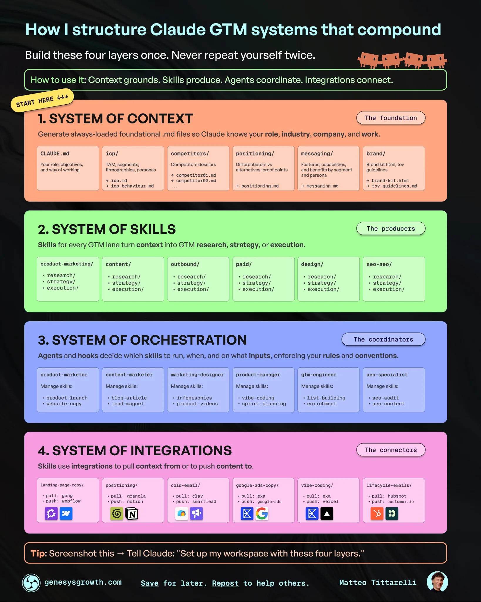
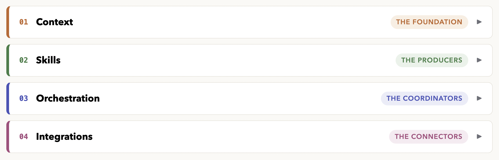

<section class="cs-sec">
  
<strong>Tools:</strong> Claude Code &middot; GA4 &middot; Google Search Console

  
A marketing system in Claude Code that knows our company, customers, competitors, and business context.

</section>

<section class="cs-sec">
  <h2 class="cs-title">01Why I built it</h2>
  
Working in enablement, I'm often faced with problems around scale. How do I scale an onboarding program to handle the increasing headcount? How do I scale sales best practices across multiple teams? How do I scale the creation of strategic content?

  
As I get more immersed in using AI, a new opportunity for scale has started to emerge.

  
How do I scale my impact in a way that previously wasn't possible?

  
The answer, like many of my enablement solutions, is to create a system. What's interesting about using AI to do this is that I'm now able to have an impact on parts of the business that I would otherwise have no ability to influence. This is especially true working on a lean revenue team where we don't have a dedicated product marketer, content strategist, or marketing ops.

  
The idea and framework for this project were sparked by Matteo Tittarelli's article <a href="https://www.growthunhinged.com/p/how-to-build-your-ai-gtm-system" target="_blank" rel="noopener">"How to build your AI GTM system"</a>. In it, he breaks down how to create an AI GTM workspace into four layers: context, skills, orchestration, and integrations.

  <figure class="cs-fig narrow">
    
    <figcaption>The four-layer framework, from Matteo Tittarelli's article on Growth Unhinged.</figcaption>
  </figure>
  
I decided to try Matteo's framework because I had already built many of the pieces from the Marketing work I've been tackling.

  
The goal was to create a system that would:

  <ul>
    <li>Reduce the context I needed to provide in my prompts</li>
    <li>Standardize the approach to repeatable tasks with skills</li>
    <li>Orchestrate the execution with specialized agents</li>
    <li>Pull in relevant data/insights from integrated tools</li>
  </ul>
  
Ultimately, this would enable me to create more specific outputs faster, with higher quality, and without having to start from scratch every time.

</section>

<section class="cs-sec">
  <h2 class="cs-title">02What I built</h2>
  
An AI GTM operating system with four layers.

  <figure class="cs-fig">
    
    <figcaption>The four layers of the system.</figcaption>
  </figure>
  
<strong>Context</strong> is the foundational layer. I've built markdown files that cover the company, our ideal customer, our services, messaging by persona, and brand voice. These files are automatically loaded, so every session starts from the same foundation.

  
<strong>Skills</strong> are the standard operating procedures that combine the context from the foundational layer with the prompt. They include marketing skills that write copy, create positioning, audit paid ads, or do SEO keyword research. The skills are tools that the agents can use to solve different problems.

  
<strong>Agents</strong> can reason, use tools, and take feedback to improve their reasoning. The system currently has four of them, one per marketing lane (product marketing, content, paid ads, SEO).

  
<strong>Integrations</strong> connect the agents to data sources. This shapes where they go to pull information and ensures that they are working with live data. I won't outline our entire stack, but they have access to a handful of analytics and data enrichment tools, including GA4 and Google Search Console.

</section>

<section class="cs-sec">
  <h2 class="cs-title">03How it works</h2>
  
The best way to explain the finished system is to follow a prompt through it.

  <figure class="cs-fig">
    <svg class="cs-flow" viewBox="0 0 640 740" role="img" aria-labelledby="flow-title" xmlns="http://www.w3.org/2000/svg">
      <title id="flow-title">Flow chart of how a prompt moves through the system: routed by description to a specialist agent or plain Claude Code, context loads in tiers, skills and integrations do the work, and the output is built on the same foundation every time.</title>
      <defs>
        <marker id="flow-arrow" viewBox="0 0 10 10" refX="8" refY="5" markerWidth="7" markerHeight="7" orient="auto-start-reverse">
          <path d="M0 0 L10 5 L0 10 z" fill="var(--muted)"/>
        </marker>
      </defs>
      <!-- connectors -->
      <line x1="190" y1="94"  x2="190" y2="128" stroke="var(--muted)" stroke-width="1.5" marker-end="url(#flow-arrow)"/>
      <line x1="190" y1="226" x2="190" y2="260" stroke="var(--muted)" stroke-width="1.5" marker-end="url(#flow-arrow)"/>
      <line x1="190" y1="340" x2="190" y2="374" stroke="var(--muted)" stroke-width="1.5" marker-end="url(#flow-arrow)"/>
      <line x1="190" y1="472" x2="190" y2="506" stroke="var(--muted)" stroke-width="1.5" marker-end="url(#flow-arrow)"/>
      <line x1="190" y1="604" x2="190" y2="638" stroke="var(--muted)" stroke-width="1.5" marker-end="url(#flow-arrow)"/>
      <line x1="360" y1="192" x2="424" y2="192" stroke="var(--muted)" stroke-width="1.5" stroke-dasharray="4 4" marker-end="url(#flow-arrow)"/>
      <text x="394" y="182" text-anchor="middle" font-family="'JetBrains Mono', monospace" font-size="10" letter-spacing=".5" fill="var(--faint)">NO MATCH</text>
      <text x="200" y="250" font-family="'JetBrains Mono', monospace" font-size="10" letter-spacing=".5" fill="var(--faint)">MATCH</text>
      <!-- 1. prompt -->
      <rect x="20" y="20" width="340" height="74" rx="10" fill="var(--paper)" stroke="var(--ink)" stroke-width="1.5"/>
      <text x="38" y="52" font-family="'JetBrains Mono', monospace" font-size="13" font-weight="700" fill="var(--green)">1</text>
      <text x="56" y="52" font-family="'Archivo', sans-serif" font-size="16.5" font-weight="700" fill="var(--ink)">A prompt comes in</text>
      <text x="38" y="76" font-family="'Mulish', sans-serif" font-size="13" font-style="italic" fill="var(--muted)">&#8220;How is the campaign performing?&#8221;</text>
      <!-- 2. routing -->
      <rect x="20" y="134" width="340" height="92" rx="10" fill="var(--paper)" stroke="var(--border)"/>
      <text x="38" y="166" font-family="'JetBrains Mono', monospace" font-size="13" font-weight="700" fill="var(--green)">2</text>
      <text x="56" y="166" font-family="'Archivo', sans-serif" font-size="16.5" font-weight="700" fill="var(--ink)">Routed by description</text>
      <text x="38" y="190" font-family="'Mulish', sans-serif" font-size="13" fill="var(--muted)">Claude compares the request against</text>
      <text x="38" y="208" font-family="'Mulish', sans-serif" font-size="13" fill="var(--muted)">each agent&#8217;s lane and picks the best fit</text>
      <!-- fallback -->
      <rect x="430" y="146" width="190" height="92" rx="10" fill="var(--paper)" stroke="var(--border)" stroke-dasharray="5 4"/>
      <text x="446" y="178" font-family="'Archivo', sans-serif" font-size="15" font-weight="700" fill="var(--ink)">Outside the lanes</text>
      <text x="446" y="200" font-family="'Mulish', sans-serif" font-size="12.5" fill="var(--muted)">Plain Claude Code</text>
      <text x="446" y="217" font-family="'Mulish', sans-serif" font-size="12.5" fill="var(--muted)">handles it directly</text>
      <!-- 3. agent -->
      <rect x="20" y="266" width="340" height="74" rx="10" fill="var(--paper)" stroke="var(--border)"/>
      <text x="38" y="298" font-family="'JetBrains Mono', monospace" font-size="13" font-weight="700" fill="var(--green)">3</text>
      <text x="56" y="298" font-family="'Archivo', sans-serif" font-size="16.5" font-weight="700" fill="var(--ink)">A specialist agent picks it up</text>
      <text x="38" y="322" font-family="'Mulish', sans-serif" font-size="13" fill="var(--muted)">Product marketing &#183; Content &#183; Paid ads &#183; SEO</text>
      <!-- 4. context -->
      <rect x="20" y="380" width="340" height="92" rx="10" fill="var(--paper)" stroke="var(--border)"/>
      <text x="38" y="412" font-family="'JetBrains Mono', monospace" font-size="13" font-weight="700" fill="var(--green)">4</text>
      <text x="56" y="412" font-family="'Archivo', sans-serif" font-size="16.5" font-weight="700" fill="var(--ink)">Context loads in tiers</text>
      <text x="38" y="436" font-family="'Mulish', sans-serif" font-size="13" fill="var(--muted)">The always-on orientation file, then the</text>
      <text x="38" y="454" font-family="'Mulish', sans-serif" font-size="13" fill="var(--muted)">detailed files its instructions point to</text>
      <!-- 5. skills + data -->
      <rect x="20" y="512" width="340" height="92" rx="10" fill="var(--paper)" stroke="var(--border)"/>
      <text x="38" y="544" font-family="'JetBrains Mono', monospace" font-size="13" font-weight="700" fill="var(--green)">5</text>
      <text x="56" y="544" font-family="'Archivo', sans-serif" font-size="16.5" font-weight="700" fill="var(--ink)">Skills and live data do the work</text>
      <text x="38" y="568" font-family="'Mulish', sans-serif" font-size="13" fill="var(--muted)">Skills read the condensed context file;</text>
      <text x="38" y="586" font-family="'Mulish', sans-serif" font-size="13" fill="var(--muted)">live data is pulled from integrated tools</text>
      <!-- 6. output -->
      <rect x="20" y="644" width="340" height="74" rx="10" fill="var(--green)"/>
      <text x="38" y="676" font-family="'JetBrains Mono', monospace" font-size="13" font-weight="700" fill="#FFFFFF">6</text>
      <text x="56" y="676" font-family="'Archivo', sans-serif" font-size="16.5" font-weight="700" fill="#FFFFFF">The output</text>
      <text x="38" y="700" font-family="'Mulish', sans-serif" font-size="13" fill="rgba(255,255,255,.85)">Built on the same foundation every time</text>
    </svg>
    <figcaption>A prompt&#8217;s path through the system.</figcaption>
  </figure>
  
The right agent is matched by description. Each agent is a file that describes the lane it owns. When a prompt comes in, Claude compares the request against those descriptions and hands the work to the best fit. Ask how a campaign is performing and the paid ads agent picks it up. If I want to control the route, I can name the agent directly in the prompt.

  
Anything outside the lanes falls back to plain Claude Code. The agents are designed to be specialists. When I'm connecting a new API or working on something none of them cover, the main session handles it like any other task. The system adds knowledge when it's relevant and stays out of the way when it isn't.

  
Once an agent picks up the task, context loads in tiers. Every session automatically loads one file: a top-level orientation document that covers the four layers, the rules that always apply, and where everything lives. The detailed context files (positioning, messaging, ideal customer, brand voice) only load when they're needed, and the agent's instructions tell it exactly which ones to read first.

  
Then the skills and integrations do the work. When a marketing skill runs, it reads a condensed context file that mirrors the full folder. Keeping that condensed file in sync is a written rule of the system, because two sources of truth can drift apart. The tradeoff is worth it because sessions use fewer tokens and nothing starts without the right background. The integrations pull in live data, so the output is built on current numbers.

</section>

<section class="cs-sec">
  <h2 class="cs-title">04What broke &amp; what I learned</h2>
  
I haven't run into any major issues yet, but I'm still early in my experimentation with the outputs.

  
One of the things I did overlook was that this system applies to anything I do in Claude that isn't related to work (such as writing this post). Funny enough, I realized this when I started working on this post. The WBM voice doesn't exactly match my own lol.

  
The fix was a rule that provides swim lanes based on the prompt: the company voice for company work, my voice for my own work, and a guideline to ask when it's ambiguous.

  
The second issue was that I realized the need for a clearance gate. Some of the content I used to create the context files has information that isn't approved to be shared externally. When I saw some of it showing up in the outputs, I added a clearance gate that flags potentially sensitive data as approved for external sharing, needing review, or not approved.

  
Overall, I'm very happy with this project. It's my first attempt at creating a proper harness for Claude, and I can notice a substantial difference in the quality of the outputs. There will be lots of tinkering to do with the context files and skills, but the foundation is in place.

</section>
