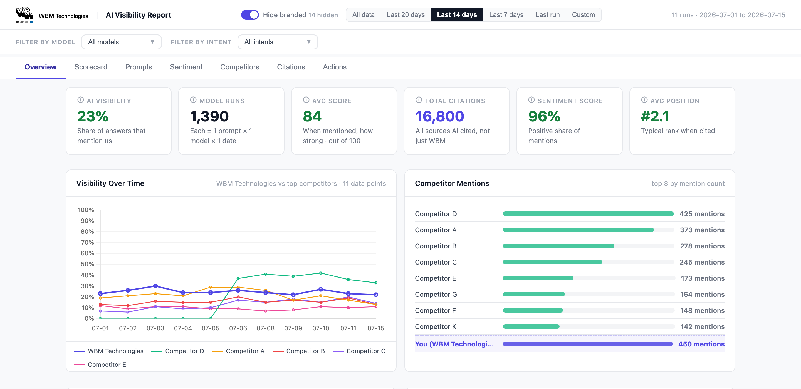
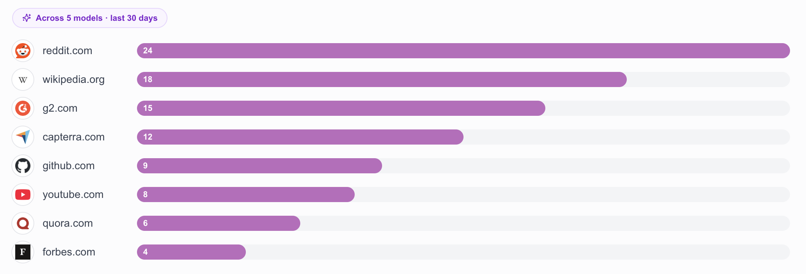
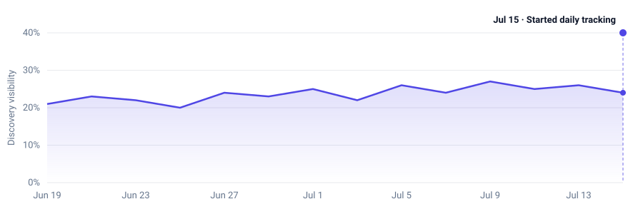

<figure class="cs-fig">
  
  <figcaption>The Overview tab. Competitors and figures anonymized for this write-up.</figcaption>
</figure>

<section class="cs-sec">
  <h2 class="cs-title">01Why I built it</h2>
  
With AI continuing to play a more prominent role in the buying journey, WBM has taken an interest in understanding how that journey is evolving and where we stand compared to our competitors. To help them with this question, I recently built an AI citation tracker.

  
The data source for the dashboard comes from a tool called <a href="https://www.aipeekaboo.com/" target="_blank" rel="noopener">Peekaboo</a>. It's an AI visibility platform that lets you benchmark your visibility against your competitors. What I like about Peekaboo is that they provide prompt-level tracking based on what you set up, and record who gets mentioned and what sources are cited. It tracks citations for ChatGPT, Perplexity, Gemini, and Google's AI answers.

  
Peekaboo has a bunch of great out-of-the-box reports, but I wanted to build something that I would have more control over.

</section>

<figure class="cs-fig">
  
  <figcaption>One of Peekaboo's built-in views: the sources AI models cite most across tracked prompts.</figcaption>
</figure>

<section class="cs-sec">
  <h2 class="cs-title">02What I built</h2>
  
I built the foundation with a GitHub repo from the Peekaboo founder (<a href="https://github.com/filipelinsduarte/ai-visibility-report" target="_blank" rel="noopener">filipelinsduarte/ai-visibility-report</a>). I kept the base report it generates and made some modifications to it. These included:

  <ul>
    <li>A toggle that hides branded prompts, so the visibility number reflects discovery instead of people already searching for WBM.</li>
    <li>A new Scorecard tab that tracks the KPIs we care about most, including an opportunity board that highlights the prompts we aren't visible for and a gap-sources list that shows the directories and forums getting cited when we are absent.</li>
    <li>An initiative tracker that tracks the dates we ship content or make changes, and maps it to our overall AI discoverability.</li>
  </ul>
</section>

<figure class="cs-fig">
  
  <figcaption>The initiative tracker marks the day we ship something and how it influences discoverability. (Sample data.)</figcaption>
</figure>

<section class="cs-sec">
  <h2 class="cs-title">03How it works</h2>
  
The report is a single dashboard that you can filter with different tabs.

  
One of the elements I'm the most happy with is the branded toggle. It's turned on by default and hides any prompt that names us directly. This makes it so that the data reflects how visible we are for unbranded prompts instead of how often we show up when someone already knows us.

  
The Scorecard also shows how each metric changed from the period before, so you can see what's trending up or down. Claude Code helped me work through the decisions and wrote the code.

</section>

<section class="cs-sec">
  <h2 class="cs-title">04What broke &amp; what I learned</h2>
  
The mistakes I made were more about the data than how I built it. When I set up our prompts, I deliberately included a batch of competitive ones, the "us versus a named competitor" comparisons, because they tell us how our brand is portrayed within our competitive set. The catch is that including any form of WBM in the prompt almost guarantees that we will be mentioned in the citations. So our share of voice and AI visibility initially looked too strong because they included data that inflated the number.

  
One of my favorite things about building with Claude is that I get to ask it what something means, why it made a certain decision, or to explain an idea in terms that match my current understanding. For this project, I wanted to make sure I understood every data source and definition on the dashboard. Regularly asking questions helped me improve the tool tips for a few of the metrics and change a few others that I didn't have any initial context around.

  
My main takeaway from this project is that AI enables you to look under the hood and understand what's going on if you take the time to ask.

</section>
