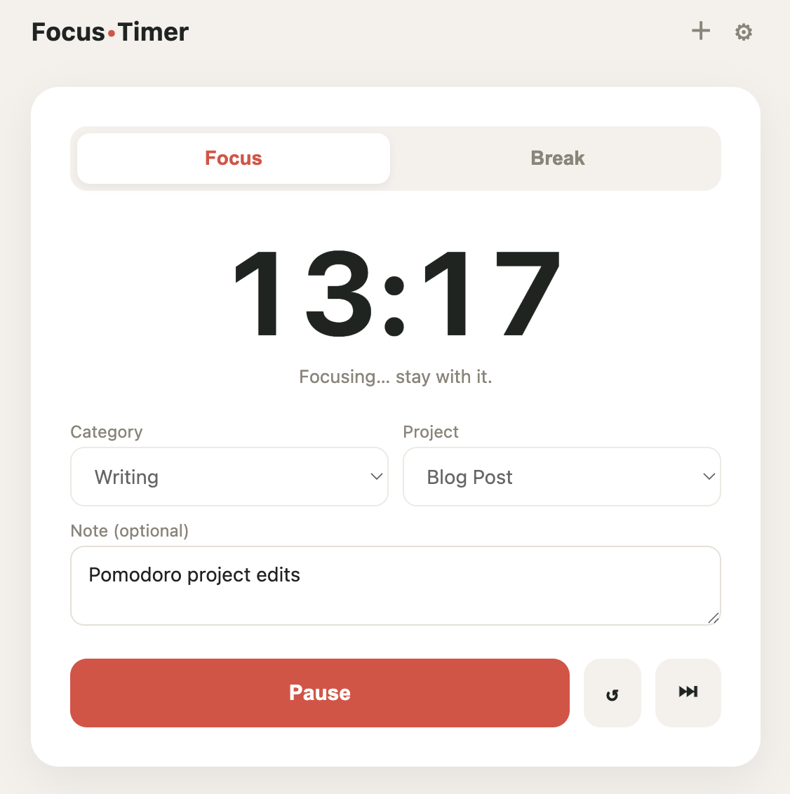
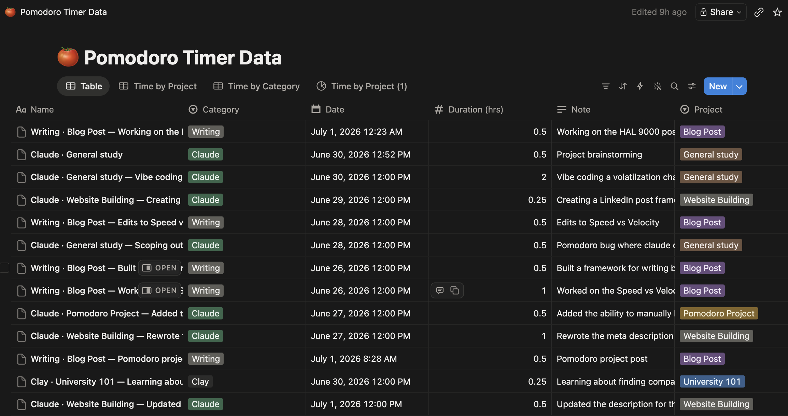

<figure class="cs-fig narrow">
  
</figure>

<section class="cs-sec">
  <h2 class="cs-title">01Why I built it</h2>
  
I've always liked the Pomodoro technique. 25 minutes of focused work. 5 minutes break. Repeat. The technique served me well back in university and continues to do so to this day. For this project, I wanted to scratch my own itch. The goal was to build a Pomodoro timer that helped me focus, while also tracking the time I'm spending working on different projects.

  
The closest I've been to SQL is a sales qualified lead, so it was also a good opportunity for me to tinker with setting up a database in Notion.

</section>

<section class="cs-sec">
  <h2 class="cs-title">02What I built</h2>
  
A Pomodoro timer that runs on my computer. I pick a category and a project, run a 30-minute block, and when it ends, the session writes itself to a Notion database. I manage the list of categories and projects inside the timer, and I can mark a project complete to see the total hours it took. The reporting lives in Notion, with grouped views for hours by project and by category.

</section>

<figure class="cs-fig">
  
</figure>

<section class="cs-sec">
  <h2 class="cs-title">03How it works</h2>
  
This was one of my first vibe coding projects, and I kept the build deliberately small. Instead of trying to build a hosted app with accounts and a login, I used Claude Code to build a local Python script that serves a browser page and writes to Notion through the API. This kept the scope small and works perfectly for just me.

  
The logged sessions live in Notion instead of being trapped in the app, so I can build whatever reporting I want on top of them.

  
Pomodoro timers typically run on a 25 minute focus/5 minute break cycle. I standardized on 30-minute blocks and decimal hours, so one session is exactly 0.5 hours. This helps the reporting come out cleaner in Notion.

</section>

<section class="cs-sec">
  <h2 class="cs-title">04What broke &amp; what I learned</h2>
  
The bugs in my life are usually limited to mosquitoes, ladybugs, and ants. Working with software bugs is a new experience for me, and I ran into a couple with this project. The first was that the timer wasn't working correctly. The timer counted down by subtracting a second every second, which I thought would make sense. However, when I switched tabs, the countdown stopped working and would occasionally freeze. I had Claude Code rebuild it to anchor to a real end time and compute what's left from the clock, then update the timer when I click back into the tab.

  
Another bug I ran into was with the data logging to Notion. In one of my study sessions, I realized that the timer said that the save was successful when nothing had actually been saved to Notion. To fix it, I restored the app's access to the Notion database and set up a process where, if the sync fails, the entry queues locally and automatically pushes the next time the app starts.

  
Overall, it was a great first project. It scratched a personal itch and taught me some lessons around planning, debugging, and working with databases.

</section>
